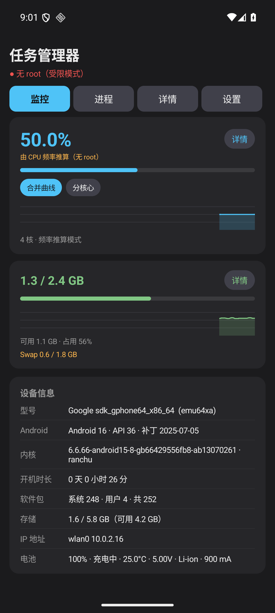
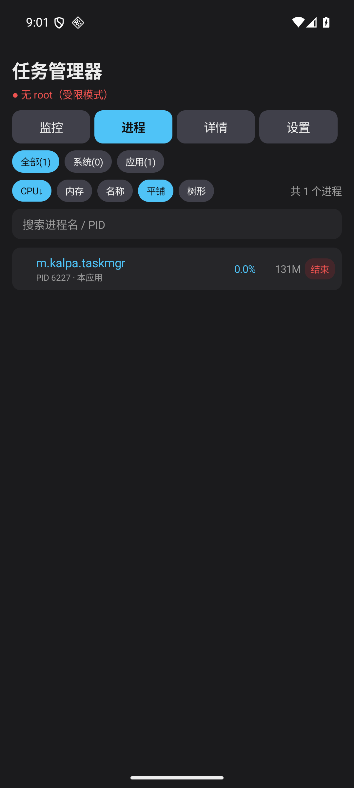
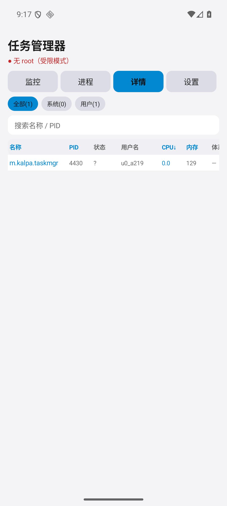
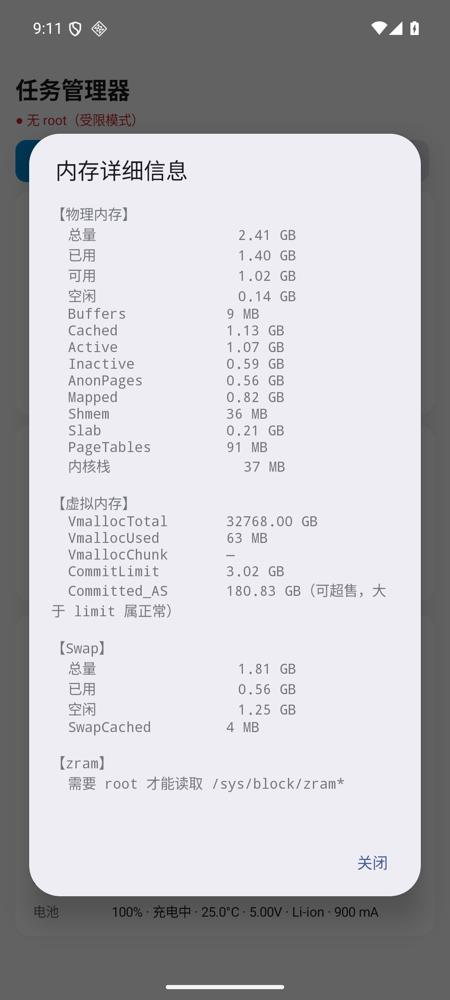

# 任务管理器 · Android Task Manager

一个 Android 平台的系统监控工具，界面参考 Windows 11 任务管理器。
**有 root 时功能完整，无 root 时也能看 CPU 频率推算、内存和设备信息。**

> 纯 Java 实现，**零第三方依赖**（UI 全部用系统控件 + 自绘折线图），APK 仅 ~118 KB。

---

## 功能

### 监控页
- **CPU 占用**：大号百分比 + 进度条 + 60 点历史折线，可切换「合并曲线 / 分核心」
- **每核视图**：每颗核心独立进度条 + 迷你折线 + 当前频率
- **内存**：已用/总量、可用量、占用率、历史折线
- **Swap / zram**：容量、压缩算法、压缩比
- **设备信息**：型号、Android 版本、内核、开机时长、软件包数量（系统/用户）、存储、IP、电池（电量/温度/电压/电流/技术）

### 进程页
- **平铺 / 树形** 两种视图（树形按父子关系折叠，默认收起）
- 筛选：**全部 / 系统 / 用户**（带数量）
- 排序：CPU / 内存 / 名称
- 搜索：进程名或 PID
- 单进程结束（root）

### 详情页
Windows 11「详细信息」风格的表格，横向可滚动：

| 名称 | PID | 状态 | 用户名 | CPU | 内存 | 体系结构 | 描述 |
|---|---|---|---|---|---|---|---|

- 表头点击排序
- 状态用中文映射并按状态着色（运行/睡眠/僵尸…）
- 体系结构读 ELF 头 `EI_CLASS` 判断 32/64 位（带 pid 级缓存）

### 设置页
- 主题：**深色 / 浅色**（含状态栏、对话框联动）
- 曲线点数：30 / 60 / 120
- 刷新间隔：1 / 1.5 / 2 / 3 / 5 秒
- 默认排序、默认分类、进程视图、隐藏内核线程、隐藏本应用

---

## 截图

| 监控 | 进程 | 详情 | 浅色主题 |
|---|---|---|---|
|  |  |  |  |

> 截图来自 Android 16 模拟器（**无 root 环境**），所以进程页只有本应用、
> CPU 显示的是频率推算值。真机 root 后数据会完整得多。

---

## root 与否的能力差异

| 功能 | 无 root | 有 root |
|---|---|---|
| 进程列表 | 仅本应用 | 全部（含内核线程） |
| CPU 占用 | **由 cpufreq 频率推算** | 精确（`/proc/stat`） |
| 每核占用 / 频率 | 部分机型可读 | 完整 |
| 内存 / Swap | ✅ | ✅ |
| zram 详情 | ❌ | ✅ |
| GPU / SoC 温度 | ❌ | ✅ |
| 结束进程 | ❌ | ✅ |
| 进程状态 / 体系结构 | ❌ | ✅ |

### 为什么无 root 要"推算" CPU？

Android 10+ 的 SELinux 策略禁止 `untrusted_app` 读取：

```
/proc/stat      → avc: denied { read } name="stat"
/proc/loadavg   → avc: denied { read } name="loadavg"
```

所以无 root 时改用 `/sys/devices/system/cpu/cpuN/cpufreq/stats/time_in_state`
（记录每个频率档位累计停留时间），差分两次采样得到**平均频率**，
再除以最高频率作为负载代理指标。界面会明确标注「由 CPU 频率推算」。

> 注意：这是**频率负载**，不是精确占用率。调频有滞后，短时尖峰可能抓不到。

---

## 构建

### 环境
- JDK 11+
- Android SDK：`platforms;android-33`、`build-tools;33.0.0`
- Gradle 7.5（仓库已带 wrapper）

### 命令行
```bash
git clone <this-repo>
cd <repo>
echo "sdk.dir=$HOME/Android/Sdk" > local.properties
./gradlew assembleDebug
# 产物：app/build/outputs/apk/debug/app-debug.apk
```

### 正式签名（可选）
在根目录新建 `keystore.properties`（**已在 .gitignore 中，不会提交**）：

```properties
storeFile=/absolute/path/to/your.jks
storePassword=******
keyAlias=your_alias
keyPassword=******
```

然后 `./gradlew assembleRelease`。
**不要**把 `.jks` 或密码提交到仓库。

---

## 权限说明

| 权限 | 用途 | 说明 |
|---|---|---|
| `QUERY_ALL_PACKAGES` | 统计已安装软件包数量 | Android 11+ 必需；Google Play 上架需声明用途 |
| `ACCESS_NETWORK_STATE` | 读取本机 IP | 普通权限，不弹窗 |

其余全部依赖 **root 授权**（通过 `su` 执行只读命令），不申请任何危险权限。

---

## 技术要点

### 1. 一次 su 调用取回全部数据
每 1.5 秒刷新一次，如果为每个数据源单独 `su` 会非常慢。
所以把 `/proc/stat`、`meminfo`、`loadavg`、`uptime`、`swaps`、
zram、cpufreq、thermal、进程表**合并成一条命令**，用分隔符切分：

```
cat /proc/stat; echo '@@@@'; cat /proc/meminfo; ... ; awk '...' /proc/[0-9]*/stat; echo '@@@@END@@@@'
```

末尾的 `@@@END@@@` 是**哨兵**：输出里没有它说明命令被超时截断，本轮数据作废并沿用上一轮，
避免列表长度忽多忽少。

### 2. 用 awk 一次扫描所有进程
避免为每个 pid 各 fork 一次：

```bash
awk 'FNR==1{ split(FILENAME,p,"/"); pid=p[3]; ... }' /proc/[0-9]*/stat
```

同时用 `getline` 顺带读 `comm`（进程名）和 `status`（uid），
一次遍历拿到 13 个字段。

### 3. 自绘折线图
`Sparkline`（约 90 行）直接操作 Canvas，无任何图表库依赖。

### 4. 主题跟随
运行时 `setTheme()` 切换 Activity 的 Android 主题，
让所有 `AlertDialog` 自动跟随深色/浅色，而不是逐个手动染色。

---

## 已知限制

- **无 root 时进程列表只有本应用** —— Android 安全模型的硬限制，不是 bug
- 部分机型 `/sys/class/thermal` 对应用不可读，温度显示为「—」
- `体系结构` 需要读 `/proc/pid/exe`，无 root 时不可用，且首次加载会分批填充
- 树形视图在进程极多（1200+）时首次渲染略慢

---

## 许可

未指定。若要开源建议选择 MIT 或 Apache-2.0，并保留本 README。
